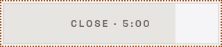
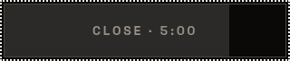
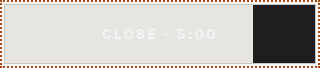
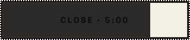

# hygiene-3: owner asks

The lane brief's no-ask record is "UI impact: none". Each ask names its surface, the options, what ships now (the arc builds that and does not wait) and a recommendation.

## OA-1 (arc 2, #517): the recovery-phrase Close's focus ring and press

- **Surface**: Settings › Backup › Recovery phrase, after the words show: the Close button with its countdown bar.
- **Background**: the Close is drawn from a hand copy of the design system's outline button that drifted in two ways. Page 37 (2026-10-17, option A) kept both as overrides "unless you say otherwise"; the lane brief asks the Close to take the design button's look instead. The two records disagree, so this asks once.
  - Focus ring, shown when the button is reached with Tab: dotted today; solid on every design button. Hand-styled controls in the wallet (the legal sheet, the send review, onboarding's back and skip links) also use the dotted ring.
  - Press: holding Space on it with the pointer away fills it with the text colour today; the design button's outline style has no pressed fill. With the pointer on it, both look the same.
  - Hover fade: its colours ease in on a slow-ending curve today; the design button's fade is the browser's default curve, over the same 0.2 s.
- **Options**:
  - A. Keep all three (dotted ring, the filled press, the slow-ending fade).
  - B. Take the design button's (solid ring, no filled press, the default fade), as every other outline button.
- **What ships now**: A. Arc 2 moves the Close onto the design button and keeps the three as overrides, proven pixel-identical; B deletes that one override rule.
- **Pictures** (Chrome, 400 px wide, the Close's box plus 4 px; A is what ships, B is the same build with the override rule deleted):

  | | A, light | A, dark | B, light | B, dark |
  |---|---|---|---|---|
  | Focus ring (Tab) |  |  |  |  |
  | Held Space, pointer away |  |  |  |  |

  Under A, the held press turns the label the page colour while the countdown bar still covers most of the button, so the words nearly vanish until the key is released (light theme most). Under B a held Space looks the same as the focus ring. The fade has no still picture; its curve is the only difference at hover.
- **Recommendation**: B. After arc 2 the Close is a design button in every other respect, and A makes it the only design button with a dotted ring and its own fade.
