# Owner asks: onboarding-3, arc 2

These asks come from the owner's second build test of #743 (2026-10-19). Each one is a visible choice that no signed rule settles. Each has a "what ships now" line, and the arc builds that line. The pictures show Chrome at the popup's real size, 360×600, in light and dark. A picture captioned **mockup** is the real Home, changed in the browser through its live styles. Nothing in a mockup is built. The numbering continues after [arc 1's asks](../archive/onboarding-3/OWNER-ASKS.md) (OA-1 to OA-16).

Already shipped in this round, signed: **P50-01 = B** (#769). A profile created beside another shows only what it lacks. A password profile shows the phrase row alone, and a passkey profile shows no card. That covers the owner's first case: passkeys imported first, then a password profile created.

**The owner's answers (2026-10-19):** OA-17 is open, with new layouts asked for (OA-21). OA-18 is B. OA-19 is the owner's note: a reset changes nothing on the card. OA-20 is A. On 2026-10-20 OA-21 is C (P69-01), which answers OA-17.

## OA-17. The padding inside the Get started rows

**Surface:** Home, the Get started card.

**Today:** each row's text sits 21 px inside a bordered box. The card fills the popup below the balance, so each option has two frames: the top, and the content scrolled by 150 px to show the card's end and Holdings. The test wallet holds no token, so Holdings shows its empty box; its dashed border sits on the page's edges, as the token rows do. The section label, the Hide link, the Holdings rows and their balances all sit on the page's 24 px edges.

| Option | Looks like | Light (top, then scrolled) | Dark (top, then scrolled) |
|---|---|---|---|
| O0. Today | the bordered box; the text 21 px inside it | 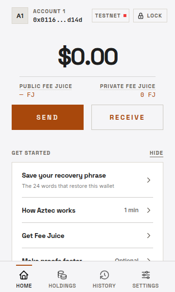  |  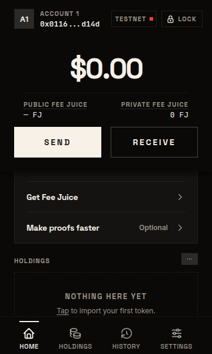 |
| O1. No box, hairlines | no border and no inner padding; a hairline between the rows across the content width; the text on the page's edges, as the Holdings rows are |   |   |
| O2. A full-width band | a line above and below the rows from one side of the popup to the other; no side borders; the text on the page's edges |   | 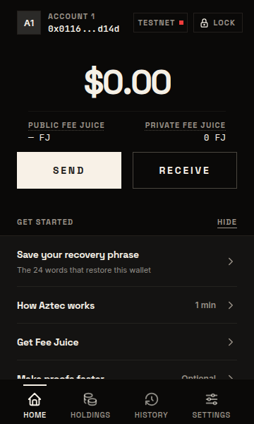  |
| O3. A tinted band | O2 with a light tint behind the rows and no lines | 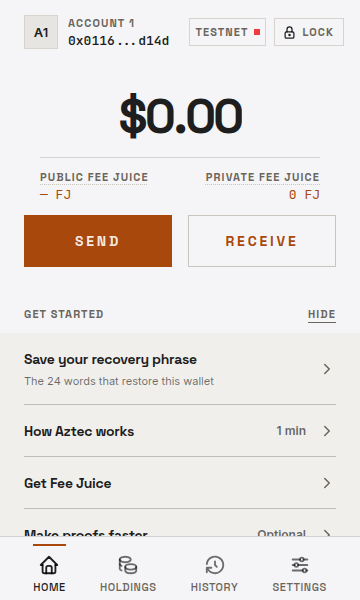  | 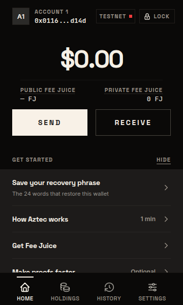 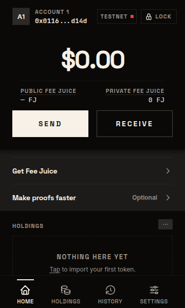 |
| O4. The Holdings rhythm | no box and no hairlines; the rows as tight as the Holdings rows; the text on the page's edges | 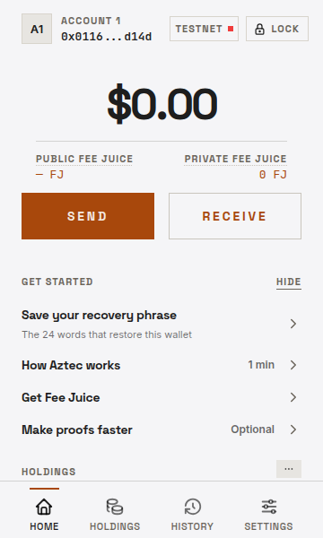  | 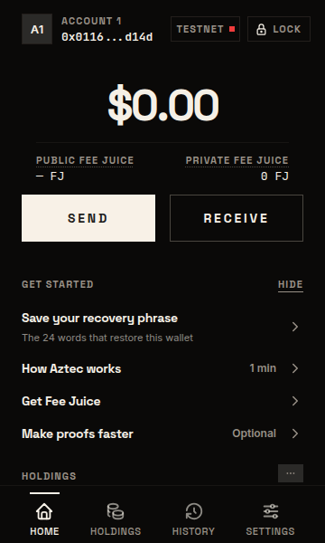 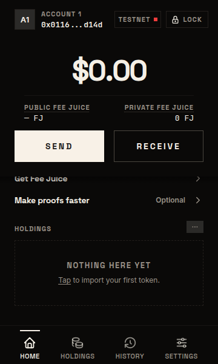 |

Two seeds were dropped. Moving the box outward leaves it 3 px from the popup's edge, and no other screen has a gap like that. A leading ring per row looks like a checkbox that never gets a check, because a row leaves when its step is done.

**Recommendation: O1** (both reviewers, moderate confidence). It puts the row text on the same edges as the label, Hide and the Holdings rows. The hairlines keep the rows apart without a box. The change stays inside the card, so the Settings lists that share these rows are untouched. **What ships now: O0, today's form.**

**Answered (P67-01): open.** "I don't like any tbh... "A" ends up being the best. Because the other ones don't look like tasks to go through. They become even more confusing. Can we get some more ideas in the table?" The new options are OA-21 (#881).

**Answered (P69-01): C**, under OA-21.

## OA-18. "Get Fee Juice" after the account held Fee Juice

**Surface:** Home, the Get started card, for the install's first created profile only. A later or imported profile never shows the row.

**Cases:** the account's Fee Juice is spent back to zero; or the person selects another account, or another network, where the account holds none; or a Testnet reset starts a new chain, where the account holds none.

**Today:** the row follows the selected account on the selected network. It leaves while that account holds Fee Juice, and it comes back when the account holds none.

| Option | What the card shows in those cases | Pictures |
|---|---|---|
| A. Today | the row comes back |   |
| B. Once held, done | the row leaves for good the first time the profile's account holds Fee Juice, as "How Aztec works" leaves once opened | 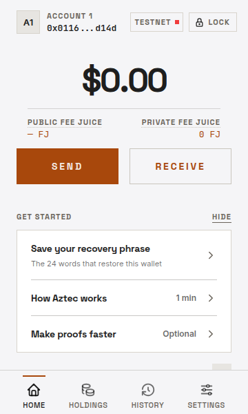  |

B stores one more per-profile flag, so it is a decision about persisted state. The flag is per profile, but Fee Juice is per account and per network. So under B, a second account that holds none never shows the row either.

**Recommendation: A** (both reviewers, moderate confidence). The owner's words are in the present tense ("check if it has fee juice"), and the row then states a true fact about the account on screen. Hide already dismisses it for good. B is per profile while Fee Juice is per account and per network, and it stores one more flag. **What ships now: A.**

**Answered (P67-02): B**, "It leaves for good the first time the profile holds Fee Juice." Built: the real build, once the profile has held Fee Juice and now holds none (spent, another account, or a reset's new chain):  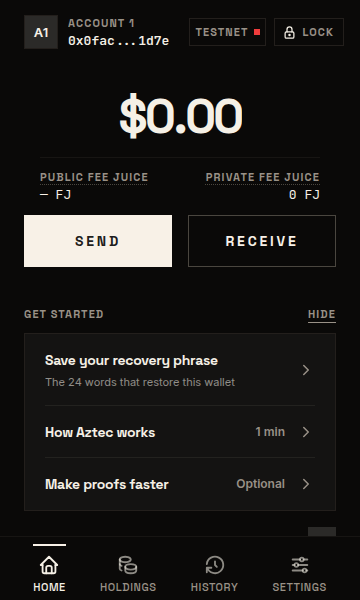

## OA-19. The card after a Testnet reset

**Surface:** Home, after the reset takeover finishes.

**The owner's words:** "Has recently "resetted" their Testnet state (we should not show anything probably)."

**Today:** a reset keeps every reminder flag, because it changes no backup and no step the person has done. The phrase or backup row stays while it is open. "How Aztec works" and "Make proofs faster" stay as they were before the reset. "Get Fee Juice" comes back, because the new chain holds none (OA-18).

| Option | After a reset | Pictures |
|---|---|---|
| A. Today | the card as before the reset, with "Get Fee Juice" back | as OA-18 A |
| B. As OA-18 B | the card as before the reset; "Get Fee Juice" does not come back | as OA-18 B |
| C. Only the backup row | the reset removes "How Aztec works", "Get Fee Juice" and "Make proofs faster"; the phrase or backup row stays while it is open (unlike Hide, which also removes a passkey wallet's backup row) | 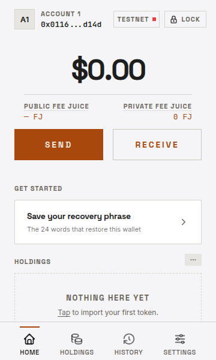  |
| D. No card | the reset removes the card, the phrase row included | not recommended: an unsaved phrase is still the only backup |

C and D store a per-profile mark written by the reset.

**Recommendation: A** (both reviewers, moderate confidence). A reset changes no backup and no step the person has done. The one row that comes back, "Get Fee Juice", is true: the new chain holds none. **What ships now: A.**

**Answered (P67-03), the owner's note in place of a pick:** "I think it should show no card. We should "migrate" the user in the sense: if the user did not finish everything, then we should migrate the state of the user. If he already knew how to get gas, then, we don't show gas. If he has already backed-up the phrase on the previous testnet, then we don't ask for it on the new testnet. Same for how aztec works. Understand my point? Like, it's the same user, he hasn't forgotten all those things, nor has he lost his phrase just because Testnet resetted." A reset changes nothing on the card: done stays done, open stays open. With OA-18 B no row reads the network, so this is A with B, and no reset mark is built.

## OA-20. An imported wallet that holds nothing

**Surface:** Home, for a profile imported from a phrase, a passkey or a full backup.

**The owner's words:** "imports account with no gas, no balance, no nothing."

**Today:** an imported profile shows no card, whatever it holds. That is the owner's OA-16 rule (#768): "if I imported: means I already have it backed up. Feels like when we import, we shouldn't show any of those things (getting started)." When the person tries to send, the Send fee card says the account has no Fee Juice, and it links to the bridge.

| Option | Looks like | Pictures |
|---|---|---|
| A. Today | no card | 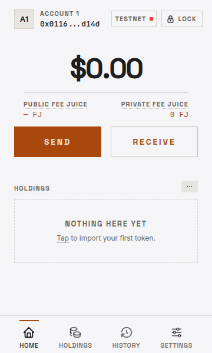 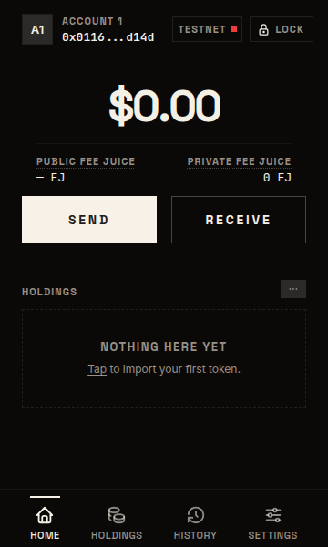 |
| B. Fee Juice alone | a one-row card, "Get Fee Juice", while the imported account holds none; no Hide |  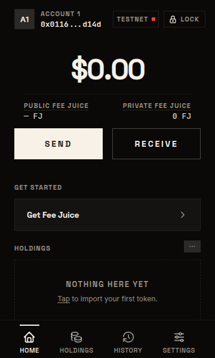 |

**Recommendation: A** (both reviewers, moderate confidence). It is the signed OA-16 rule. B would add a row with no Hide, which today only the backup reminder has. **What ships now: A.**

**Answered (P67-04): A.** Nothing changes.

## OA-21. Get started rows that read as tasks (#881)

**Surface:** Home, the Get started card.

**The owner's bar (P67-01):** rows that read as tasks to work through. A's bordered box is the best so far, and the other OA-17 options read worse.

**How these are drawn:** each option is the live Home with the card rebuilt in the browser from the wallet's own colors and type roles. Nothing is built. Each one is shot for the install's first password profile with no Fee Juice, first with nothing done, then with two steps done: the phrase saved and How Aztec works opened. A frame marked "scrolled" shows the card's end when the card passes the fold. Today's card is OA-17's O0.

**What every option with a count needs:**
- *Which rows count:* the rows the profile started with. On the install's first profile those are the phrase row (the backup row on a passkey profile), How Aztec works, Get Fee Juice and Make proofs faster, so four. A later profile shows only its phrase row, and an imported one shows no card, so neither shows a count.
- *Which flags say "done":* the phrase or backup flag, How Aztec works' flag, the Fee Juice flag from OA-18 B, and the Presto setting. The Presto setting is one setting for the whole install.
- *Make proofs faster is optional.* The drawings count it. Under an option where done rows stay, a profile that never sets it up keeps a card of checked rows until Hide.

| Option | What changes | Nothing done (light, dark) | Two done (light, dark) |
|---|---|---|---|
| Q1. A with a progress line | Today's box, with a thin bar and "n of 4 done" under the label. A done row still leaves. Needs the count's flags only. |  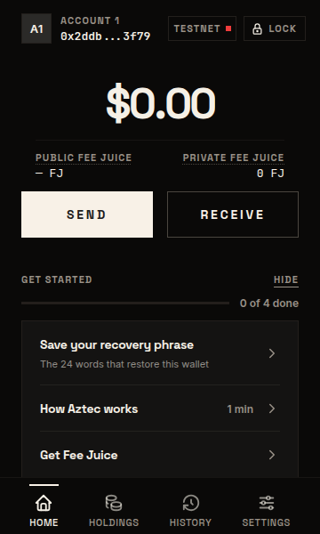 scrolled: 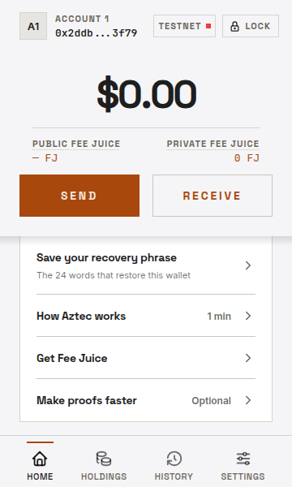  |   |
| Q2. Checklist | A's box opens with "n of 4 done" and a bar. Each row has a square that fills with a check. A done row stays, struck through, with "Done", and the card leaves once all four are done. |  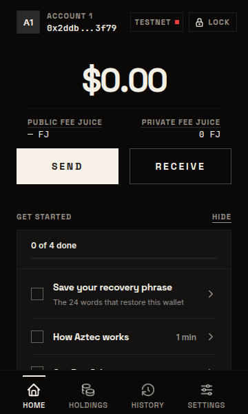 scrolled: 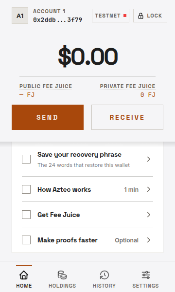 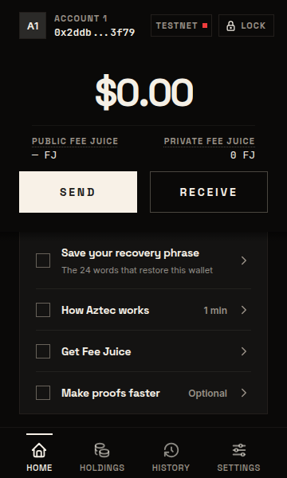 | 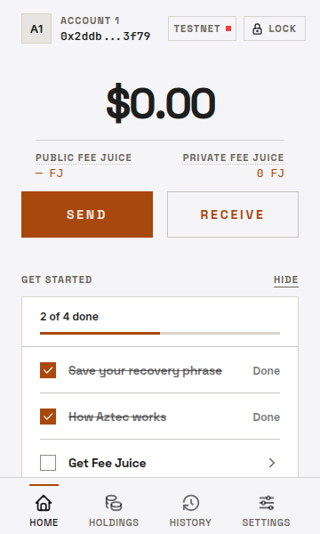 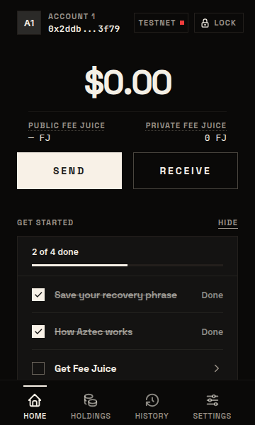 scrolled:  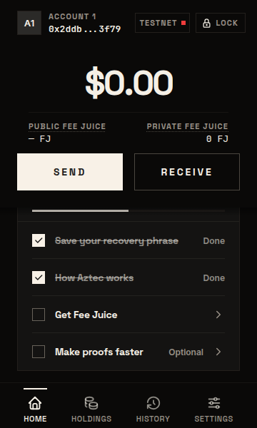 |
| Q3. Numbered steps | A's box with a number before each row. The next step's number is filled. A done step's number turns into a check and the row stays, and the card leaves once all four are done. "n of 4 done" sits on the label's line. The numbers set an order, the one drawn. | 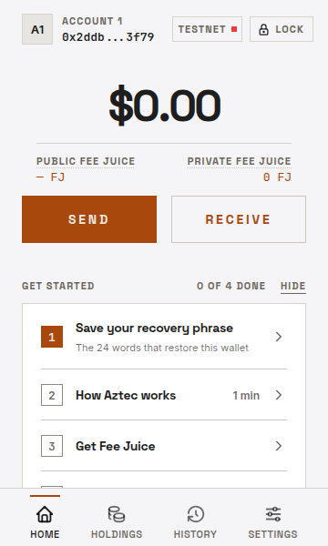  scrolled: 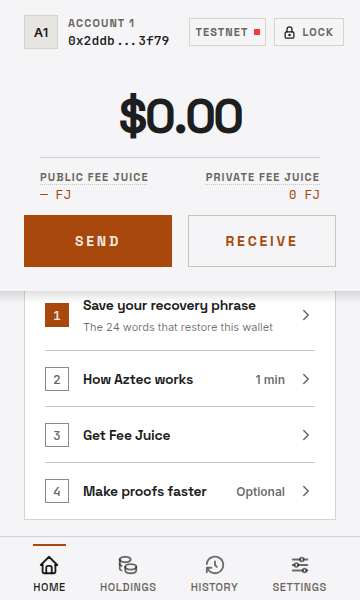 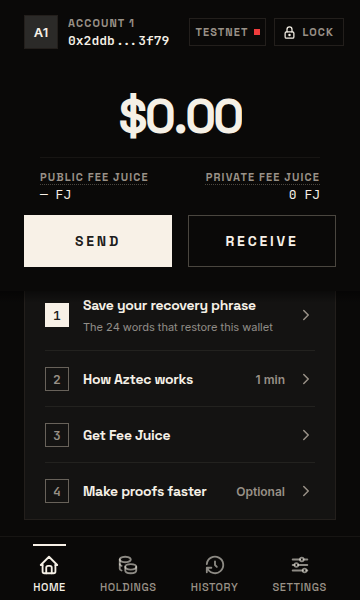 |   scrolled: 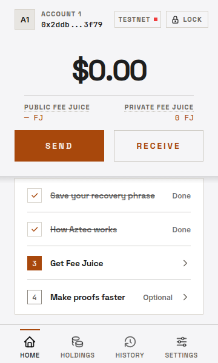 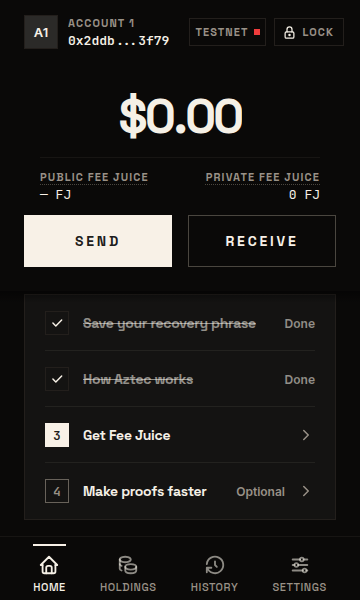 |
| Q4. One step at a time | "Step 1 of 4" with four segments, the next step alone, and a foot with "Next: …" and an "All steps" link that opens the list. The card fits above the fold. Needs the count's flags, an order, and whether "All steps" is open. |  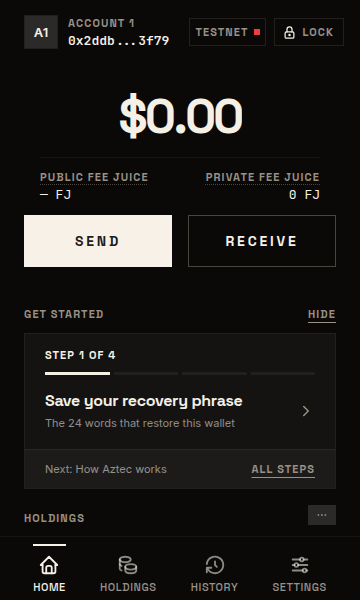 | 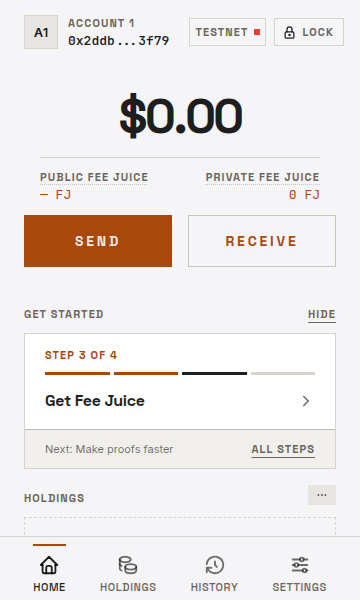  |
| Q5. Tiles | The four steps in a 2×2 grid, each with its number and a square that fills. A done tile stays. The card fits above the fold. The grid needs four steps, so a later profile's single phrase row stays a row. | 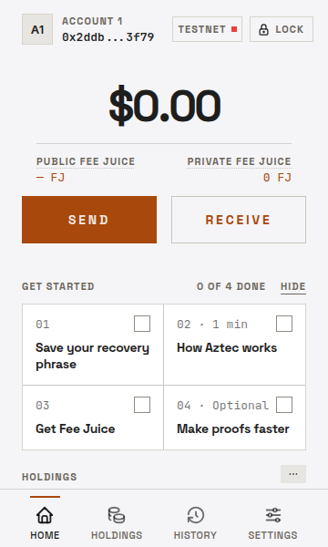 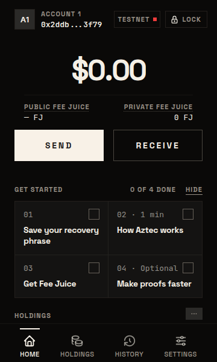 | 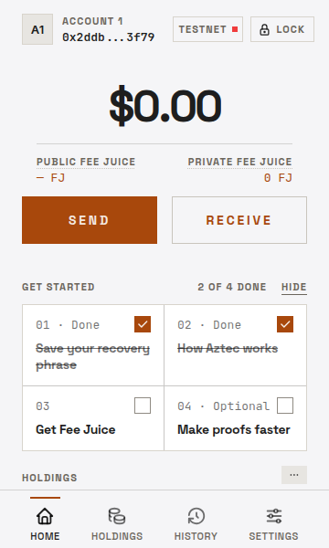 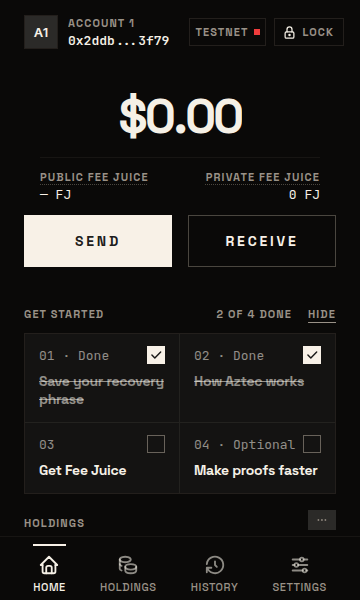 |
| Q6. Rail | A line joins the steps. The next step is open, with its description, on a tint, and the others are one line each. A done step's node fills with a check and the row stays. |  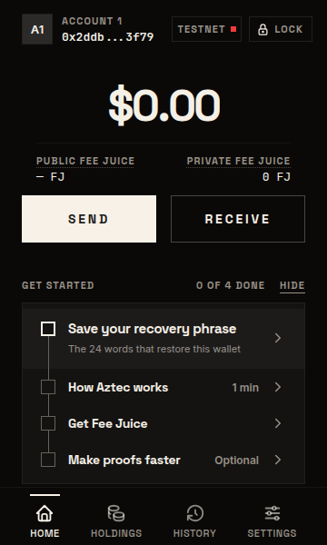 scrolled: 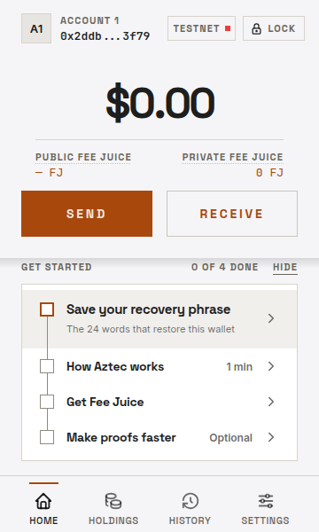 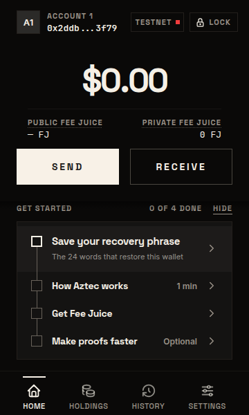 |  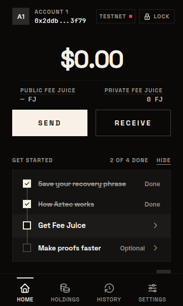 |

The brief's ring before each row is drawn as a square (Q2, Q5) and a node (Q6), because the wallet has no round control. It appears only where a done row stays and gets its check.

**Recommendation: Q3** (moderate confidence). It keeps A's box, which the owner rated best. Every row reads as a step, with the next one marked. Done steps stay checked, so progress shows. The count sits on the label's line, so the card gets no taller than it is today. **What ships now: today's form (OA-17's O0). #743 does not merge until this is picked and built.**

**Answered (P69-01): C**, "Numbered steps: the next step's number is filled, a done number turns into a check and the row stays; the count sits on the label's line." Built (the real build, light then dark):

| Cell | Light | Dark |
|---|---|---|
| A first password profile, nothing done |  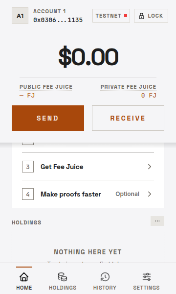 | 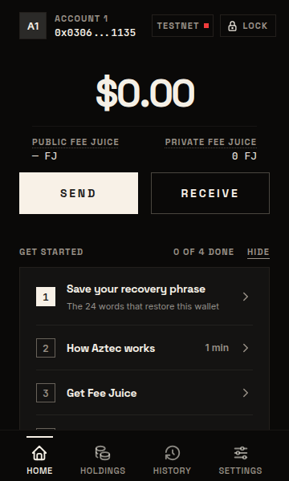 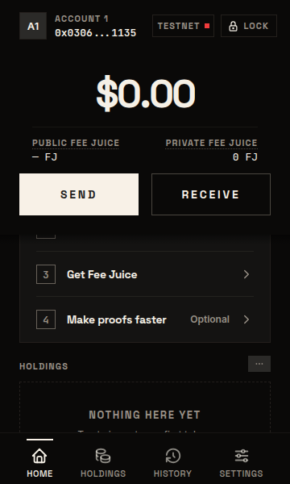 |
| The phrase saved and How Aztec works opened | 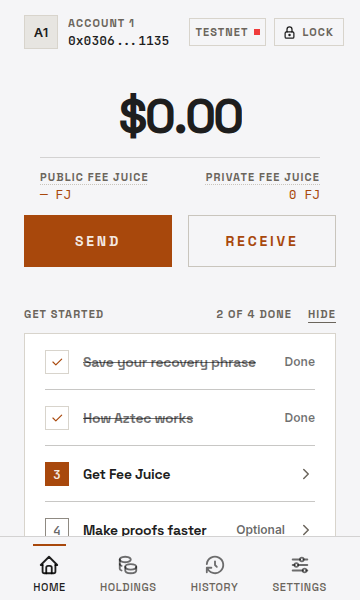 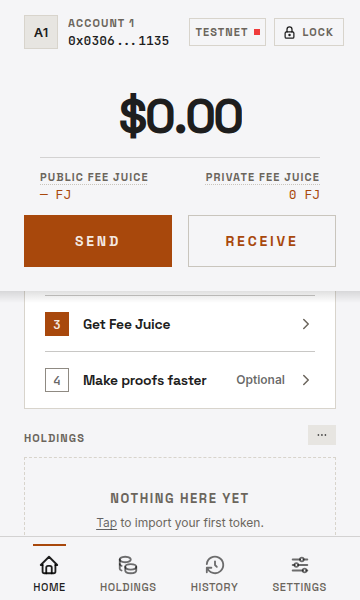 | 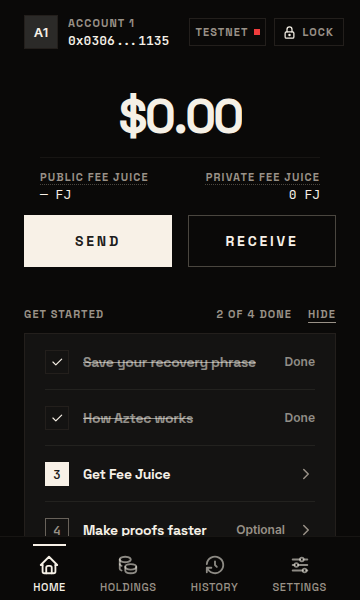 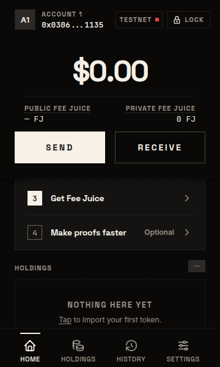 |
| The profile has held Fee Juice (P67-02 B) |  |  |
| The phrase step alone (Hide, or a later profile): no count, no Hide | 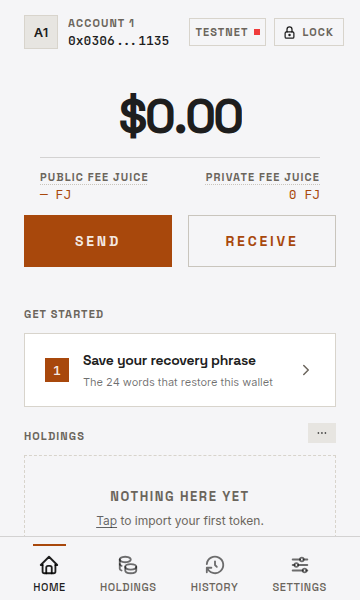 | 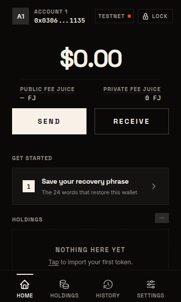 |
| A first passkey profile, nothing done |  |  |
